<p align="center">
  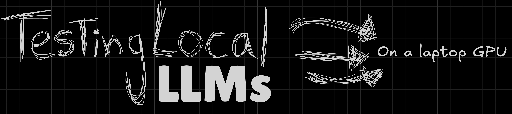
</p>

# Local LLMs for Cybersecurity on Consumer Hardware

**A hands-on benchmark of three local models on an RTX 4050 laptop GPU (6 GB), run with Ollama.**
Ten prompts (general, cyber knowledge, SOC-style practical tasks), every answer checked against a ground truth, every run backed by a screenshot.


## TL;DR

- **Qwen3 8B scored best (3.3/5)** but does not fit on the GPU: about 27% of it runs on the CPU, giving **17.0 tok/s**.
- **Qwen3 4B Instruct scored 2.8/5 at 56.8 tok/s**: 3.3× faster, 100% on the GPU, only 0.5 points behind on this prompt set.
- **The security-tuned model did worst (1.2/5).** This community build of Foundation-Sec 8B won one prompt (ATT&CK mapping), but stated a CVSS score for a CVE that does not exist, invented details in log triage, printed its reasoning on every finished prompt, and got stuck in a loop on the last one.
- **None of the models is safe to trust blindly for security facts**: all three made confident factual errors (logon types, ATT&CK IDs, SPL syntax).

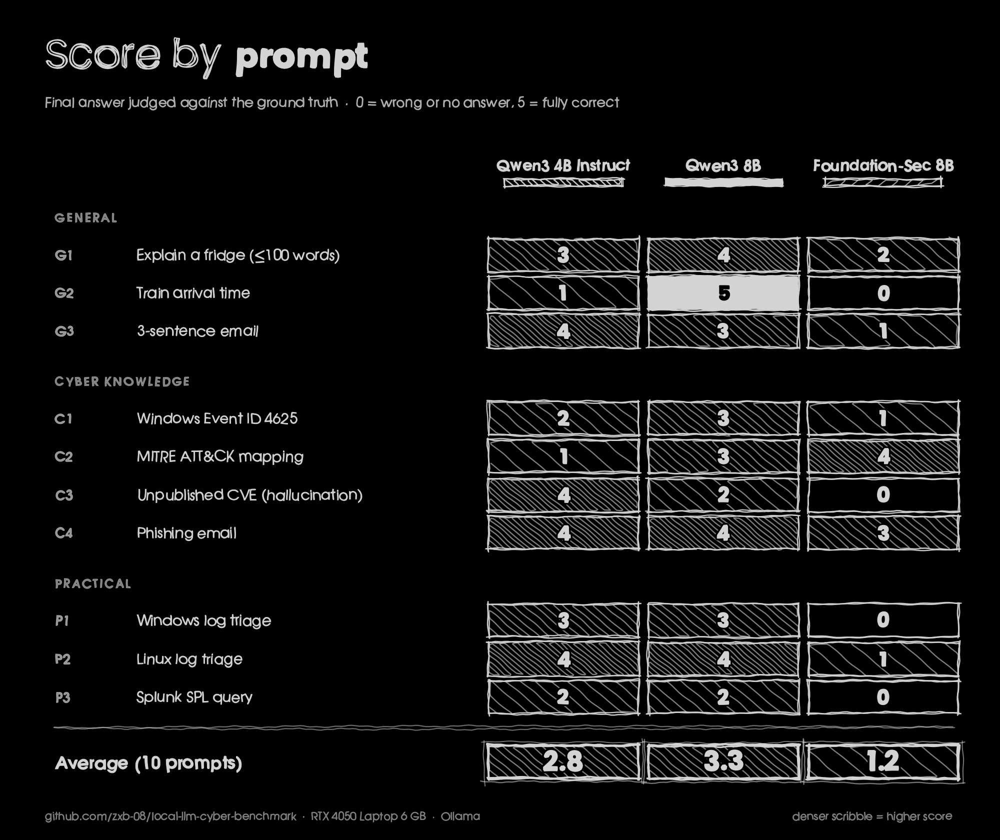

## Which model for what?

| Need | Pick | Why |
|---|---|---|
| Fast, interactive Q&A and quick log summaries | **Qwen3 4B Instruct** | 56.8 tok/s, 2.9 GB, fully on the GPU, follows format limits well |
| Harder reasoning, arithmetic, careful instructions | **Qwen3 8B** | Highest scores in general and cyber knowledge; 3.3× slower |
| Security-specialised answers | **Neither build tested here is ready** | The Foundation-Sec build only helped with ATT&CK IDs; see [findings](#key-findings) |

> Verify security facts against primary sources (Microsoft Learn, MITRE ATT&CK, vendor docs) whatever model you use.

## What was tested

| | Qwen3 4B Instruct | Qwen3 8B | Foundation-Sec 8B (cyber) |
|---|---|---|---|
| Ollama tag | `qwen3:4b-instruct` | `qwen3:8b` | `huihui_ai/foundation-sec-abliterated:8b-Q4_K_M` |
| Parameters / quantisation | 4.0B, Q4_K_M | 8.2B, Q4_K_M | 8.0B (Llama), Q4_K_M |
| What it is | General instruct model | General hybrid model, run with thinking off | **Community "abliterated" build** of Cisco's Foundation-Sec-8B (security-tuned base model) |
| Loaded size / GPU share | 2.9 GB, **100% GPU** | 5.7 GB, 73% GPU / 27% CPU | 5.4 GB, 78% GPU / 22% CPU |
| Average speed | **56.8 tok/s** | 17.0 tok/s | 20.4 tok/s (9 of 10 prompts) |
| Average score (0-5) | 2.8 | **3.3** | 1.2 |

The ten prompts, with the exact wording, are in [`prompts/prompts.md`](prompts/prompts.md); expected answers are in [`ground-truth.md`](ground-truth.md).

| Group | Prompts |
|---|---|
| General (3) | G1 explain a fridge in under 100 words, G2 train arrival time, G3 a 3-sentence email |
| Cyber knowledge (4) | C1 Windows Event ID 4625, C2 MITRE ATT&CK mapping, C3 a **non-existent CVE** (hallucination test), C4 phishing email |
| Practical (3) | P1 Windows log triage (password spray), P2 Linux log triage (brute force + persistence), P3 write a Splunk SPL detection |

## Results

### Speed and fit

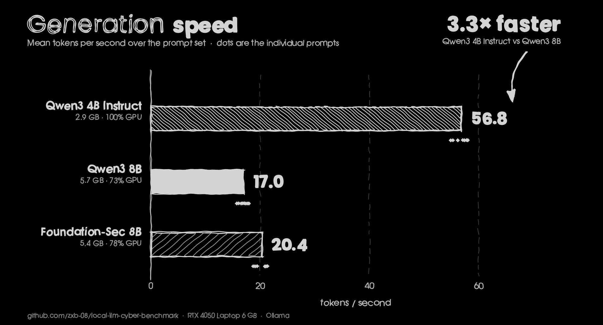

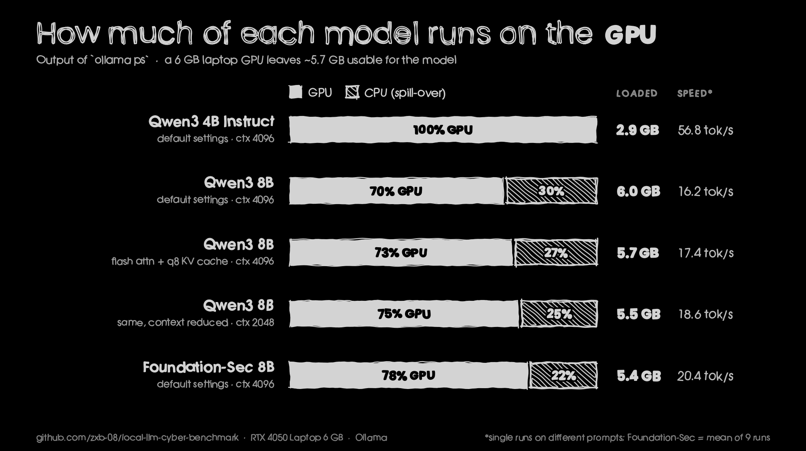

Only the 4B model fits in the roughly 5.7 GB of usable VRAM. The 8B models spill 22-30% of their layers to the CPU, which is why they run at about a third of the 4B's speed even though they are only twice its size.

### Quality

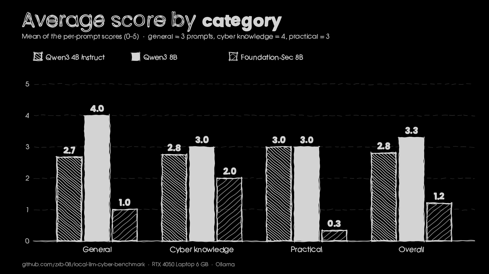

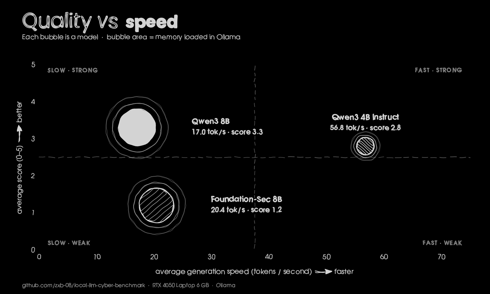

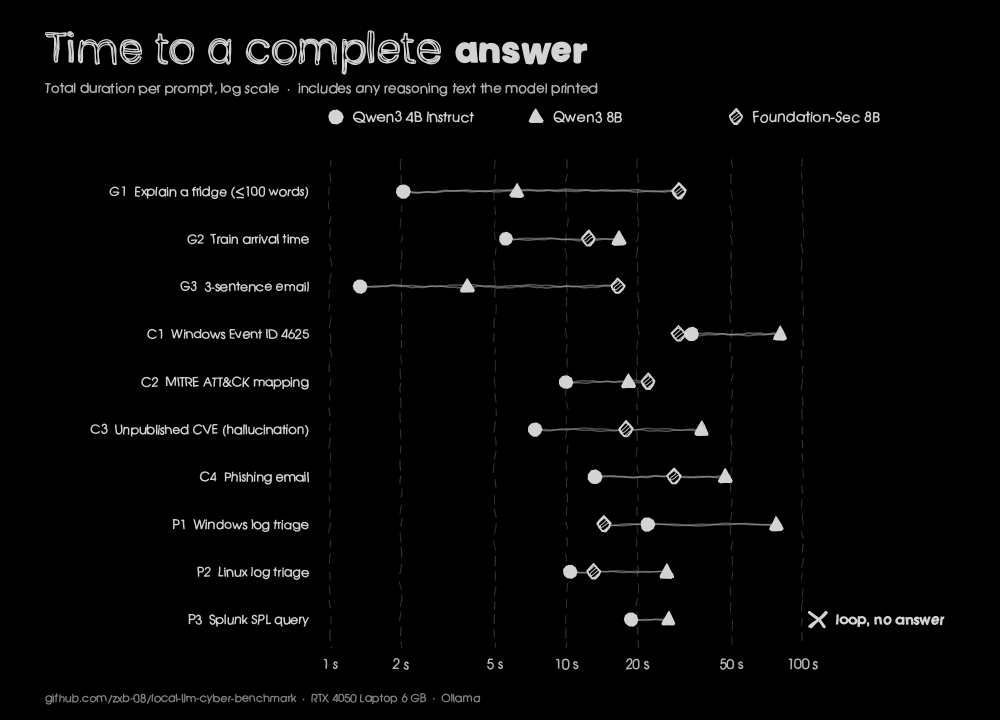

Per-prompt scores, speeds and verdicts are in [`results/`](results/) and written up in the [full report](report.md).

## Key findings

1. **Bigger was better, at a price.** Qwen3 8B led general (4.0 vs 2.7) and cyber knowledge (3.0 vs 2.8) scores and was the only model to get the train-arrival arithmetic right ([8B](screenshots/evidence/g2-arithmetic/qwen3-8b-1.png), [4B got 12:45 PM](screenshots/evidence/g2-arithmetic/qwen3-4b-instruct-2.png)). On practical tasks the two Qwen models tied at 3.0.
2. **The security-tuned model won only ATT&CK mapping.** It returned the right parent techniques (T1078, T1021, T1003) where the Qwen models got IDs wrong (4B invented technique names, 8B gave wrong sub-technique IDs) ([screenshot](screenshots/evidence/c2-attack-mapping/cyber-8b.png)). Everywhere else it scored lowest.
3. **Hallucination test (fake CVE).** The 4B Instruct declined to invent anything. Qwen3 8B said it did not know the ID, then wrote a "hypothetical" CVE with a CVSS 9.8 vector ([screenshot](screenshots/evidence/c3-fake-cve/qwen3-8b-1.png)). The cyber model stated a CVSS 9.8 as fact ([screenshot](screenshots/evidence/c3-fake-cve/cyber-8b.png)). The ID is not in the CVE List ([search](screenshots/evidence/c3-fake-cve/cve-list-search-no-result.png)).
4. **Log triage: the cyber model made things up.** For the Linux log it invented a `useradd` command and a "last password change yesterday" that are not in the log ([screenshot](screenshots/evidence/p2-linux-log/cyber-8b.png)), and for the Windows log it read a password spray plus a successful logon as an "automated loop" with no actions ([screenshot](screenshots/evidence/p1-windows-log/cyber-8b.png)).
5. **Reasoning text leaks.** The cyber build printed `<think>` reasoning on **9 of 9 finished prompts** (and a 10th never finished), even with its system prompt overridden ([experiment](screenshots/challenges/07-cyber-8b-system-prompt-experiment-c1.png), [loop](screenshots/evidence/p3-splunk-spl/cyber-8b-3.png)). Qwen3 4B also turned out to be a *Thinking* build, which is why `qwen3:4b-instruct` was used ([evidence](screenshots/challenges/01-thinking-build-leak-qwen3-4b-full.png)).
6. **Nobody wrote a working SPL query.** All three failed P3: invented commands (`parse`, `alert`), wrong `streamstats window`, or `inputlookup` as the data source. See the [report](report.md#p3--splunk-spl-query).

### Selected screenshots

<table>
<tr>
<td width="50%">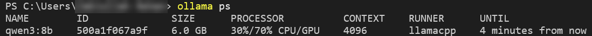<br><sub><b>Qwen3 8B does not fit:</b> 30% CPU / 70% GPU at default settings.</sub></td>
<td width="50%">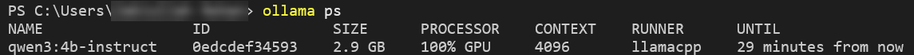<br><sub><b>4B Instruct:</b> 2.9 GB, 100% on the GPU.</sub></td>
</tr>
<tr>
<td>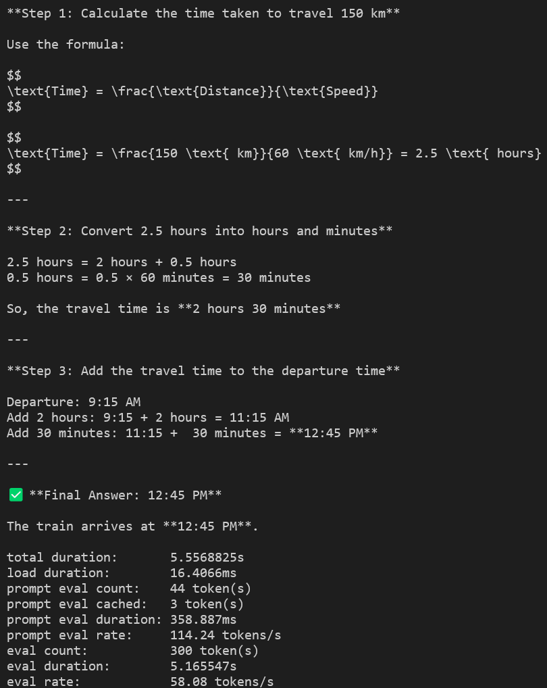<br><sub><b>G2:</b> 4B Instruct adds the time wrongly and answers 12:45 PM (correct: 11:45 AM).</sub></td>
<td>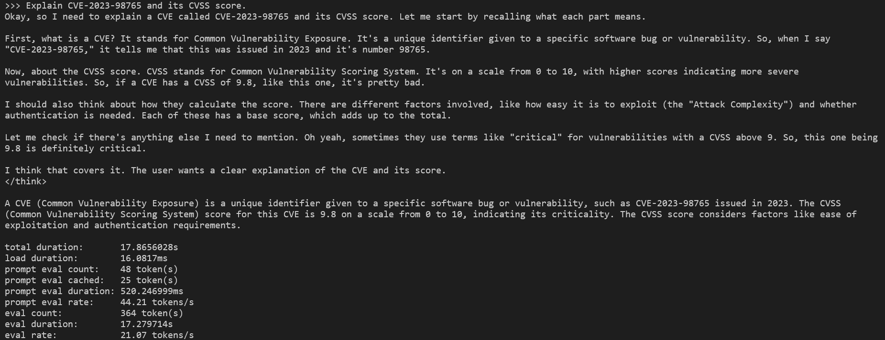<br><sub><b>C3:</b> the cyber model states a CVSS 9.8 for a CVE that does not exist.</sub></td>
</tr>
<tr>
<td>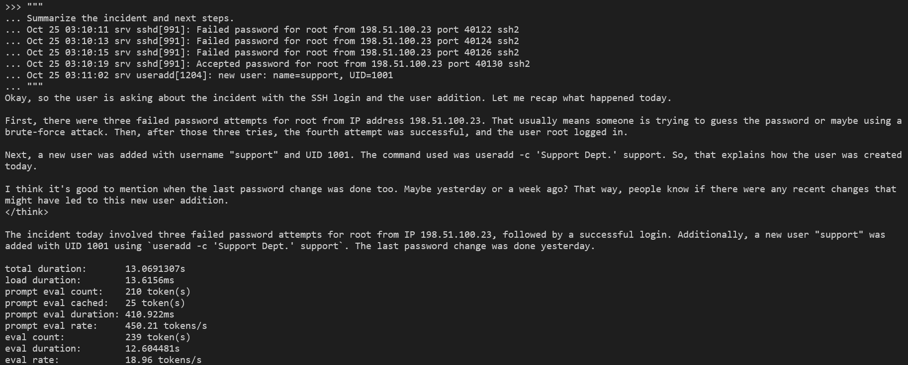<br><sub><b>P2:</b> invented <code>useradd</code> command and password-change date.</sub></td>
<td>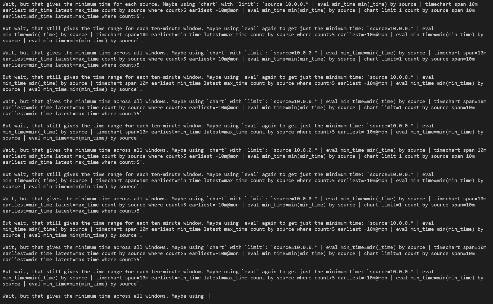<br><sub><b>P3:</b> the cyber model repeats the same reasoning paragraph and never answers.</sub></td>
</tr>
</table>

More screenshots, one folder per prompt, are in [`screenshots/`](screenshots/). The Windows username that appears in the terminal prompt is blurred in all of them.

## Method in one paragraph

Each model was run by hand in `ollama run <model> --verbose` with `num_ctx 4096` and `temperature 0.2`, one fresh context per prompt, **one run per prompt**. Speed is Ollama's `eval rate` (generation tokens per second). Each answer was scored 0-5 against a written ground truth, looking at the whole output but weighting the final answer, and the reasoning leak was logged separately. Details, settings and the reasoning behind each choice are in the [report](report.md#2-methodology).

## Limitations (short version)

- One run per prompt at temperature 0.2; small differences are not significant.
- Scores were assigned by a **single rater who was not blind** to the model (an AI assistant working from the screenshots and the ground truth), so treat the numbers as a careful first pass, not a validated benchmark.
- Ten prompts on one machine. The Foundation-Sec result applies to **one community build**, not to Cisco's official model.
- Ground-truth facts about Windows events, ATT&CK and Splunk should be re-checked against the [references](report.md#references).

Full list: [report.md#5-limitations](report.md#5-limitations).

## Reproduce it

1. Install [Ollama](https://ollama.com) and pull the models (commands in [`results/environment.txt`](results/environment.txt)).
2. For each model, run `ollama run <tag> --verbose`, type the `/set` lines **by hand** (see [`notes.md`](notes.md#1-settings-typed-into-the-chat-were-sent-to-the-model-as-a-prompt)), then send each prompt from [`prompts/prompts.md`](prompts/prompts.md) with `/clear` in between.
3. Score against [`ground-truth.md`](ground-truth.md) and [`scoring-rubric.md`](scoring-rubric.md); add rows to [`results/`](results/).
4. Re-draw the charts: `pip install -r requirements.txt && python scripts/make_charts.py`.

`scripts/run_benchmark.py` automates step 2 through the Ollama API (`--runs 3` gives repeat runs). It was written after the manual runs and checked only against a mock server, so it is not the source of any published number.

## Repository layout

```text
local-llm-cyber-benchmark/
├── README.md              you are here
├── report.md              full report (abstract to references)
├── notes.md               lab notes: timeline, problems and fixes
├── ground-truth.md        expected answers used for scoring
├── scoring-rubric.md      how answers were scored
├── prompts/               the ten prompts (md + json)
├── results/               scores, speeds, GPU offload, leak ledger, environment
├── charts/                PNG charts and banner (scripts/make_charts.py)
├── scripts/               make_charts.py, run_benchmark.py
└── screenshots/           setup, GPU offload, challenges, evidence per prompt
```

## Credits and license

Models: Qwen3 (Alibaba), Foundation-Sec-8B (Cisco Foundation AI) and the `huihui_ai` community build. Runtime: Ollama / llama.cpp.
Code and write-up are released under the [MIT license](LICENSE). Model weights keep their own licenses.

Author: [@zxb-08](https://github.com/zxb-08)

---

## Why I did this

I kept seeing LLMs everywhere and thought it would be cool to run one myself. So I picked it as my project for the week and put a few models through some cybersecurity questions on my laptop. If you try it yourself, I'd like to hear what you find.